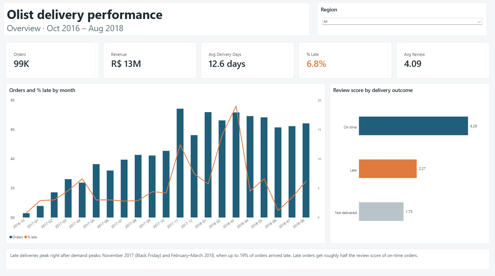
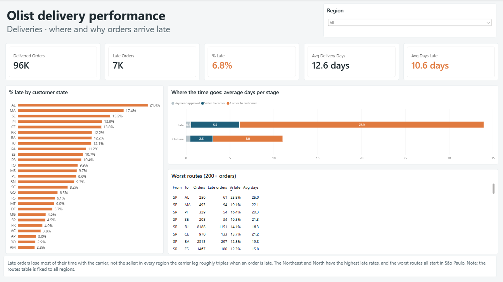
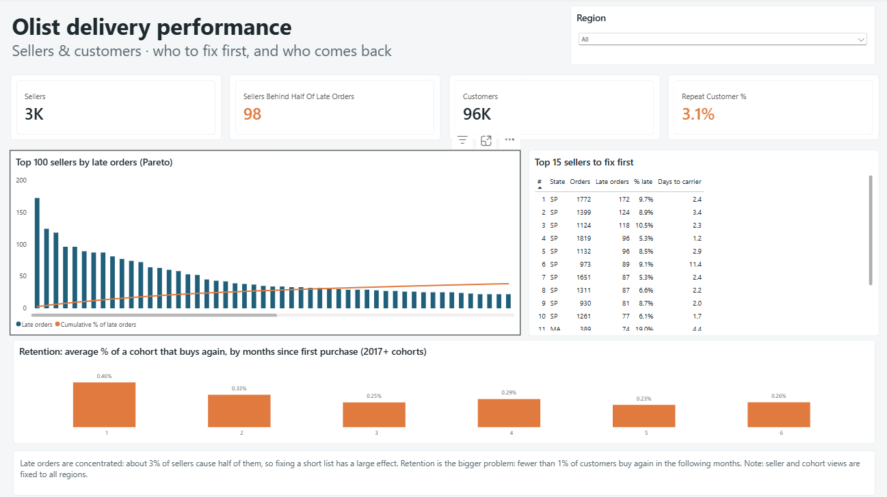

# Operations analytics platform (Olist)

End-to-end analytics on the public [Olist Brazilian e-commerce dataset](https://www.kaggle.com/datasets/olistbr/brazilian-ecommerce):
about 100,000 real, anonymised orders from 2016–2018.

**Business question:** where and why do orders arrive late, and which sellers or routes should be fixed first?



```
Kaggle CSVs → Python (ingestion + data-quality checks) → PostgreSQL (staging → star schema)
→ SQL KPI views → Power BI
```

## Status

- [x] Stage 1: ingestion and data-quality checks into `staging`
- [x] Stage 2: star schema (`dw`)
- [x] Stage 2b: KPI views (`dw.kpi_*`)
- [x] Stage 3: Power BI report (3 pages)

## Run it

1. Install PostgreSQL and create a database called `olist`.
2. Download the dataset from Kaggle and unzip the 9 CSV files into `data/raw/`.
3. Install dependencies and set the connection:
   ```bash
   pip install -r requirements.txt
   cp .env.example .env      # then edit the password
   ```
4. Load and check the data, then build the star schema:
   ```bash
   python src/ingest.py        # ~3-4 min, mostly the 1M-row geolocation file
   python src/build_model.py   # ~10 s
   ```

## Power BI report

Three pages, all sharing a region filter:

| Page | Question it answers |
|---|---|
| Overview | How big is the problem, and does it hurt reviews? |
| Deliveries | Where are orders late, and which stage of the delivery loses the time? |
| Sellers & customers | Which sellers to fix first, and do customers come back? |




The report is saved as a **Power BI project (PBIP)**: the model (tables, relationships, DAX measures) is stored as TMDL text files and every page and visual as JSON, so changes show up as readable diffs in Git.
To open it, run the two Python scripts, open `powerbi/olist_delivery_performance.pbip` in Power BI Desktop and press **Refresh**.

Main DAX measures:

```dax
% Late = DIVIDE([Late Orders], [Delivered Orders])          -- undelivered orders can't be late
Revenue = CALCULATE(SUM(fact_deliveries[items_value]),
                    NOT fact_deliveries[order_status] IN {"canceled", "unavailable"})
Repeat Customer % = VAR c = ADDCOLUMNS(VALUES(fact_deliveries[customer_key]),
                                       "@orders", CALCULATE(COUNTROWS(fact_deliveries)))
                    RETURN DIVIDE(COUNTROWS(FILTER(c, [@orders] > 1)), COUNTROWS(c))
```

## Data-quality checks

Every run checks each file before it reaches the database and logs the results to `dq.check_results`.
Rows that fail a blocking check are left out of staging and listed in `dq.rejected_rows`.

| Check | Action |
|---|---|
| Expected columns present | Stop the run |
| Null or duplicate primary key | Reject row |
| Foreign key with no parent (e.g. item for an unknown order) | Reject row |
| Price ≤ 0, freight or payment < 0, review score outside 1–5 | Reject row |
| Delivered before purchase, carrier before approval, "delivered" with no date | Keep, log warning |

Parents load before children, so a rejected order also removes its items, payments and reviews.

## Star schema (`dw`)

| Table | Grain | Notes |
|---|---|---|
| `fact_order_items` | one item in an order | price, freight; links product, seller, customer, date |
| `fact_deliveries` | one order | duration of each delivery stage in days, `days_late`, `is_late`, review score |
| `dim_customer` | one real customer | keyed on `customer_unique_id`: Olist creates a new `customer_id` for every order |
| `dim_seller` | one seller | |
| `dim_product` | one product | category in English, `unknown` for the 610 products without one |
| `dim_geography` | one 5-digit zip prefix | city, state, region; ~1M raw GPS points averaged into one point per prefix |
| `dim_date` | one day | |

An order is late when it arrives on a calendar day after the estimated date.

## KPI views

| View | Answers |
|---|---|
| `kpi_monthly` | orders, revenue, freight, ticket, % late and review score per month, with month-over-month change |
| `kpi_seller_delivery` | sellers ranked by late orders, with cumulative share of all late orders (Pareto) |
| `kpi_route_delivery` | % late and days per route, seller state → customer state |
| `kpi_stage_breakdown` | days spent in each delivery stage, late vs on-time orders, per region |
| `kpi_customer_cohorts` | retention by month of first purchase |

## First findings

- 6.8% of delivered orders arrive late. Delivery takes 12.6 days on average against a promise of 23.7.
- Late orders get an average review of 2.3 out of 5, against 4.3 for on-time orders.
- The Northeast has twice the late rate of the Southeast (12.7% vs 6.1%). The worst routes all start in São Paulo.
- Most of the delay is in the carrier leg, not at the seller: in the Northeast a late order spends 36 days with the carrier against 14 for an on-time one, while seller handling goes from 2.7 to 4.3 days.
- 98 of 2,970 sellers (3.3%) account for half of all late orders.
- Fewer than 1% of customers buy again in any given month after their first purchase; only 3.1% of customers ever place a second order.

## Recommendations

1. **Renegotiate or replace carriers on the Northeast and North routes.** The carrier leg is where late orders lose time, and São Paulo → Northeast routes are late up to 24% of the time.
2. **Work with the 98 sellers behind half of the late orders.** A short, named list makes this actionable.
3. **Plan logistics capacity before demand peaks.** Late rates jumped after Black Friday 2017 and in February–March 2018.
4. **Treat retention as a separate problem.** Late deliveries cut review scores in half, but even on-time customers rarely return.

## Project layout

```
src/schema.py     expected columns, types, keys and value rules for each file
src/ingest.py     reads the CSVs, runs the checks, writes staging and dq tables
src/build_model.py  runs the SQL files in sql/model and sql/kpis in one transaction
sql/model/        star schema: dimensions, then facts
sql/kpis/         KPI views for Power BI (stage 3)
powerbi/          Power BI project (PBIP): TMDL model, report JSON and theme
data/raw/         CSVs from Kaggle (not committed)
```
